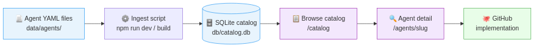
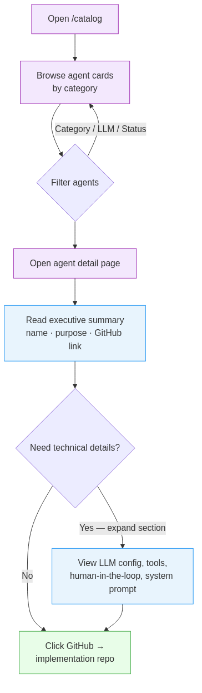

# AIC Agent Library v. 0.1

A browse-and-discovery catalog for the AI agents produced for the AI Champion (AIC) consortium. It is one of the main WP5 outputs. This repository does not contain the agents themselves, but the code for the website presenting and showcasing them. With the catalog, tech evaluators and engineers can find the right agent for their use case. One can filter by discipline, read an executive summary, expand technical details when needed, and follow a link straight to the GitHub implementation.

---

## What it does

The AIC consortium produces AI agents that automate workflows across engineering, operations, and project management. This library is the front door to that catalog — a fast, searchable index where you can:

- **Browse** agents by category, LLM, and maturity status
- **Read** a plain-language summary of what each agent does and when to use it
- **Inspect** the technical specification (LLM config, tools, human-in-the-loop requirements) when you need the details
- **See** which fields are tailorable for your environment before you open the GitHub repo

The platform is a discovery tool, not a runtime. Agents live in GitHub; this library helps you find the right one.

---

## How it works

Each agent is described in a YAML file using the Oracle AgentSpec format. On startup, the platform ingests those files into a local catalog database and serves a SvelteKit web app.



---

## Getting started

**Prerequisites:** Node.js 20+

```bash
# 1. Clone and install
git clone https://github.com/aic-consortium/aic-agent-library
cd aic-agent-library
npm install

# 2. Configure access and email delivery
cp .env.example .env
# Edit .env: add allowed addresses and either Brevo settings or SMTP_SERVER.

# 3. Start the development server
#    (runs db schema push, ingests agent files, starts the web app)
npm run dev
```

Open [http://localhost:5173](http://localhost:5173) — you land on the catalog automatically.

For a production build:

```bash
npm run build
npm run preview
```

### Search / embeddings

Catalog search uses local sentence embeddings (`@huggingface/transformers`, no external API) next to keyword search.

- Install with `ONNXRUNTIME_NODE_INSTALL_CUDA=skip npm install` (or `npm ci`); without it the onnxruntime-node postinstall hangs on a CUDA download.
- The first ingest downloads the ~90 MB model once (about 90 s) into `HF_CACHE_DIR` (default `./db/models`).
- `SEARCH_EMBEDDINGS=off` forces keyword-only (BM25) search and skips the model entirely.
- Offline or model unavailable: ingest logs a warning and search falls back to BM25 only.
- Tests never download or load a model (`SEARCH_EMBEDDINGS=off` is set in the vitest config).

---

## Adding agents

Drop a YAML file into `data/agents/` and restart the server. The ingest step runs automatically on `npm run dev` and `npm run build`.

A minimal agent file looks like this:

```yaml
component_type: Agent
id: "your-org-agent-001"
name: "Your Agent Name"
description: "One sentence describing what this agent does."
metadata:
  category: "mechanical"        # discipline or domain
  maturity: "experimental"      # experimental | beta | production
  tags:
    - "your-tag"
  input_schema:
    - key: "project_name"
      label: "Project name"
      type: "text"               # text | textarea | number | select
      required: true
      description: "Project to process"
    - key: "building_type"
      label: "Building type"
      type: "select"
      required: true
      options:
        - value: "office"
          label: "Office"
        - value: "residential"
          label: "Residential"
system_prompt: "You are a ..."
llm_config:
  name: "claude-sonnet-4-6"
  default_generation_parameters:
    max_tokens: 2048
    temperature: 0.2
tools:
  - name: "tool_name"
    description: "What this tool does"
human_in_the_loop: false
```

Re-running ingest on an existing agent ID updates the record — it never creates duplicates.

---

## Using the catalog



**Catalog page** (`/catalog`)
- Cards display each agent's name, summary, category, maturity badge, and tags
- Three filter dropdowns — **Category**, **Model**, and **Status** — narrow the list instantly without a page reload
- Pagination handles large catalogs without layout degradation

**Detail page** (`/agents/<slug>`)
- The executive summary (name, purpose, GitHub link) is visible by default
- Click **Technical Specification** to expand LLM config, tools, and system prompt details
- The **Customization Options** panel lists which fields of the agent are tailorable for your environment

---

## What's coming

| Phase | What it adds |
|-------|-------------|
| Search | Natural language + keyword search, results update as you type |
| Customization | "Customize" entry point with wizard flows for well-defined configuration patterns |

---

## Deploying with Podman

The repo includes a `Containerfile`, `.containerignore`, and `podman-compose.yml`
for running the built server in a container.

```bash
# Build the image (multi-stage: installs deps, runs the full build
# pipeline — schema push, YAML ingest, vite build — then copies the
# result into a slim runtime image)
podman build -t aic-agent-library -f Containerfile .

# Run it
podman run -d --name aic-agent-library -p 3000:3000 aic-agent-library

# Or with podman-compose
podman-compose up -d --build
```

Open [http://localhost:3000](http://localhost:3000).

The catalog data is baked into the image at build time from `data/agents/`.
To pick up new or changed agent YAML files, rebuild the image.

Before starting with Podman, copy `.env.example` to `.env` and replace its
placeholder values. `podman-compose` loads this gitignored file at runtime; it
is not copied into the image.

### Passwordless consortium access

All catalog, agent and Try out routes require a passwordless sign-in. Access is
limited to the exact addresses listed in `AUTH_ALLOWED_EMAILS` and addresses in
the domains listed in `AUTH_ALLOWED_EMAIL_DOMAINS`. A whitelisted user receives
a six-digit, single-use code through Brevo by default. If
`SMTP_SERVER` is configured, the code is sent through that unauthenticated SMTP
relay instead. Codes expire after 10 minutes and lock after five failed attempts.
Code requests are limited to three per email address in a 15-minute window.
Every address to which a code was successfully sent is retained in the
`login_code_recipients` table of the authentication database, along with the
first and latest send timestamps and the total send count.

Authentication is enabled by default. To allow access without signing in, set
`AUTH_ENABLED=false` in `.env` and restart the application. When authentication
is disabled, the email whitelist and email transport settings are not used.

Authentication variables in `.env`:

| Variable | Purpose |
|----------|---------|
| `AUTH_ENABLED` | Optional; set to `false` to disable authentication (default: enabled) |
| `AUTH_ALLOWED_EMAILS` | Comma-separated list of exact allowed addresses |
| `AUTH_ALLOWED_EMAIL_DOMAINS` | Optional comma-separated list of allowed domains, e.g. `example.org,partner.example.org` |
| `BREVO_API_KEY` | Brevo API key used by default; not required when `SMTP_SERVER` is set |
| `SMTP_SERVER` | Optional hostname for an unauthenticated plain-TCP SMTP relay; overrides Brevo |
| `SMTP_PORT` | Optional SMTP relay port (default: `25`) |
| `AUTH_EMAIL_FROM` | Sender address; must be verified in Brevo when Brevo is used |
| `AUTH_EMAIL_FROM_NAME` | Display name for the sender |
| `ORIGIN` | Public base URL, e.g. `http://localhost:3000` locally or the production HTTPS URL |
| `AUTH_COOKIE_SECURE` | `false` for local HTTP, `true` for production HTTPS |

Authenticated sessions last seven days. Only a random session token is stored
in an HttpOnly, SameSite=Lax cookie; the server database stores its SHA-256
hash. With `podman-compose`, login state and rate-limit data persist in the
separate `auth-data` volume. The public `/health` endpoint remains available for
container health checks.

Other env vars the container respects: `PORT` (default `3000`),
`CATALOG_DB_PATH`, `AUTH_DB_PATH`, `TRYITOUT_WORK_DIR`,
`TRYITOUT_PROMPTS_DIR`, and the `PI_*` runner knobs (see `.env.example`).

### Trying out an agent

Agents configured with `try_it_out_mode = 'runnable'` show the runnable Try it out panel.
The build configures the `demo-rfi-triage` agent for this mode. Opening a runnable
agent's page warms a per-session Pi container (from the generic `pi-runner` image).
A user supplies a task and an optional text file; jobs run `pi --mode json` inside
that container, progress (including Pi tool calls) streams to the feed through
`/api/tryitout/jobs/*`, and the download is a zip of the job's `output/` directory.

Pi's LLM calls go through the app's `/api/llm` proxy using a per-lease token; the
real `OPENAI_API_KEY` stays in the app and is never given to a container. If the
container engine is unreachable or a container fails to start, the job falls back
to the direct model call (never when the runner is merely busy). Toggle with
`PI_FALLBACK_ENABLED`. All `PI_*` knobs are documented in `.env.example`.

Set `OPENAI_API_KEY` in `.env` before starting the application. Job metadata is
kept in memory, so active and completed job links do not survive an application
restart.

#### Setting up the Pi runner

1. Enable the user socket: `systemctl --user enable --now podman.socket`
2. Build the image: `podman build -t localhost/pi-runner:latest -f Containerfile.pi-runner .`
3. Start the app: `podman-compose up -d --build`. The compose file mounts the host
   Podman socket into the app, and attaches it to the internal network
   `aic-pi-internal` (alias `aic-agent-library`); Pi containers get no external egress.
4. Check the host with the smoke script: `npx tsx scripts/smoke-pi-runner.ts`
   (add `--proxy-host aic-agent-library` once the app is running). It prints the
   `PI_RUNNER_FS_MODE` to use (`tmpfs` preferred, `layer` if the host needs it).

Local development with `npm run dev` (verified on rootless Podman 4.9.3, Ubuntu 24.04): the
socket comes from `$XDG_RUNTIME_DIR`; set `PI_RUNNER_NETWORK=podman`,
`PI_RUNNER_ALLOW_OPEN_EGRESS=true` and
`PI_LLM_PROXY_URL=http://host.containers.internal:5173/api/llm/v1`, and start Vite with
`npm run dev -- --host` (it binds all interfaces so containers can reach it;
`vite.config.ts` allows the `host.containers.internal` Host header in dev).

Operational notes: run a single app replica per engine user (orphaned containers are
cleaned up at start-up on that assumption). Mounting the socket gives the app control
over that user's containers, so use a dedicated host user. A dedicated runner user
would need a relay container and only `PI_LLM_PROXY_URL` changes; that variant is not
built in this phase. Resource limits need cgroup v2 delegation for rootless Podman.

Hardening notes (Phase 9): set `APP_INSTANCE_NAME` (for example `aic-prod`) in compose
deployments. Pi containers are labelled with it (`aic.owner`) and the start-up orphan
sweep only removes leftovers with the same owner, so a dev server and the compose stack can
share one Podman socket; without it the container hostname is used and changes whenever the
container is recreated, so leftovers are not swept. Built-in limits (not env-configurable):
every proxied model call is capped at 4096 completion tokens (and charged that amount when
the provider reports no usage), a job keeps at most 2000 progress events, a Pi output line
over 1 MiB is skipped, and a hung engine call is abandoned after 15 s (container remove) or
60 s (job staging and output fetch).

The runtime image only ships production dependencies (`npm prune --omit=dev`
after the build) — build-only tooling like `vite`'s CLI, `drizzle-kit`, and
`tsx` never reaches the running container.

---

## Technical documentation

For stack choices, data model, ingestion pipeline, component structure, and contribution guidelines, see [TECHNICAL_DOCUMENTATION.md](TECHNICAL_DOCUMENTATION.md).

### Agent types and intake

Research output from Phase 12; hosting of multi-agent systems and other formats is not yet implemented.

- [docs/agent-types.md](docs/agent-types.md): taxonomy of agent kinds, topologies and frameworks with per-format findings.
- [docs/agent-capability-matrix.md](docs/agent-capability-matrix.md): what each type needs, stores and shows, and Try It Out suitability.
- [docs/agent-intake-guide.md](docs/agent-intake-guide.md): what authors should send, readiness checklist and a reply template.
- [docs/agent-hosting-decision-memo.md](docs/agent-hosting-decision-memo.md): recommended model changes, ranked adapters and open questions.

---

*Part of the AI Champion (AIC) consortium project.*
